# Reinforcement learning for trading: a laboratory study

*RL Trading Lab · daily data through 2026-11-12 · every number is after transaction costs · environment version 2*

## Summary

**On daily data with realistic execution, none of the nine RL algorithms beat simple strategies out of sample,
and nothing, rule or agent, beat buy & hold SPY on returns.** The lab's controls show that this is a finding about
the markets and the data, not a failure of the implementations.

* **Controls pass.** On synthetic markets with a planted, learnable edge, PPO, A2C and Moody-Saffell recurrent RL
  (RRL) reach test Sharpe ratios of 0.64-1.19. On a pure random walk no agent makes money. Given a feature that
  reveals the next session's return, all nine algorithms reach a Sharpe of 12-14.
* **SPY, 2007-2018, walk-forward.** Six 2-year test blocks, three seeds each. The agents score 0.19-0.53 against
  buy & hold's 0.41. No paired test against buy & hold has p < 0.39. Every agent is below the 50/200-day trend
  filter (0.61) and volatility targeting (0.56).
* **Corrected for the search.** Of 72 strategies evaluated on the same windows, the best information ratio
  against buy & hold is −0.03 (deflated probability of skill 0.17). The strategies with higher Sharpe ratios got
  there by holding less risk in 2008, not by earning more.
* **Multi-asset.** Agents trail simple allocation rules. ETF portfolio: best agent 0.52 against minimum variance
  1.09 and 60/40 1.00. Futures: 0.59 against 1.18. Single stocks: 0.04 against the trend filter's 0.43.
* **What the lab learned about method.**
  1. Validation Sharpe does not predict test Sharpe (rank correlation −0.08 over 162 runs).
  2. Training to the end beat validation-selected checkpoints for six of nine algorithms.
  3. Seed-to-seed and run-to-run variance is as large as the effects being studied.
  4. Value-based agents need short horizons when the agent cannot move the market.
  5. A single subtly leaky feature produces Sharpe 5-7, and fools validation just as much.
  6. High-turnover agents lose half their Sharpe by about $20M of capital, even in SPY.
* **Reward hacking appears in mild, realistic forms.** A risk stop without a penalty invites more risk, and
  penalties collapse exposure while the Sharpe ratio survives. The textbook zero-variance cash exploit exists in
  the raw differential-Sharpe reward (worth 3.65 per year against the 2.25 actually earned), but PPO never found it.
* **Holdout (2019-01 to 2026-11, evaluated once).** Buy & hold has a Sharpe of 0.77. The ten RL configurations
  score 0.67 down to −0.52, all below it (paired p ≥ 0.69). The development ranking of the agents reversed
  (rank correlation −0.63): the best development agents (TD3, Double DQN, Q-learning) were among the worst out of
  sample. The hyperparameter-tuned PPO (0.40) again trailed the untuned default (0.61). Its search was later
  found to have rewarded flat policies through a metric bug, which was fixed and the search repeated (Sections
  7.8 and 9).

An independent audit of the code (Section 9) found no look-ahead in the train/validation/test pipeline but
several real problems in data, costs and statistics. All were fixed before the results below. Runs completed
before the fixes were re-scored under the corrected environment from their saved checkpoints.

## 1. Question and approach

The question is not whether an RL agent can produce a good backtest (it always can). It is whether
reinforcement learning adds anything over simple, well-understood strategies once execution is realistic and
evaluation is honest. The lab follows five rules:

1. **Baselines first.** Buy & hold, random, momentum, mean reversion, supervised models and portfolio
   optimisation run through the *same* environment and pay the same costs.
2. **Controls before conclusions.** Every algorithm is first run on synthetic markets with a known answer. If an
   algorithm cannot find a planted edge, its failure on real markets says nothing.
3. **No frictionless prices, no look-ahead.** Fills happen at the next open with spread, slippage, impact and
   commission. Features use past bars only, and anything fitted is fitted on training rows. Tests delete the
   future and check that nothing in the past changes.
4. **Walk-forward evaluation with a locked holdout.** Six expanding-window folds on SPY, and a 2019-2026 holdout
   evaluated once at the end, with every access logged.
5. **Statistics that account for search.** One statistic for every strategy (Sharpe of one daily series) with
   bootstrap confidence intervals, paired tests against buy & hold, and deflated Sharpe ratios over everything
   tried.

## 2. Data

| Universe | Instruments | History used | Purpose |
|---|---|---|---|
| `spy` | SPY | 1993-01 to 2026-11 | the single-asset environment the study starts from |
| `etf9` | SPY, QQQ, IWM, EFA, EEM, TLT, IEF, LQD, GLD | 2004-11 to 2026-11 | cross-asset portfolio |
| `eq10_2000` | GE, XOM, PFE, C, CSCO, WMT, MSFT, AIG, MRK, INTC | trained from 2001 | the ten largest S&P 500 members on 31-Dec-2000 |
| `fut4` | ES, NQ, YM e-minis; ZN 10-year note | 2002-04 to 2026-11 | futures mechanics: multipliers, whole contracts, no borrow |
| `pool19` | SPY + 8 ETFs + 10 stocks | trained from 2001 | cross-sectional pooling for single-instrument agents |
| synthetic | random walk, GARCH, AR(1), regime switching, block bootstrap | 6,000 sessions | controls and randomised training |

Data come from Yahoo Finance chart API daily bars (cached in `data/raw/`); the risk-free rate is the T-bill
yield (^IRX).

* **Prices.** P&L uses total-return prices. Tick-size spreads and contract sizing use the prices that actually
  traded. Liquidity (ADV) uses split-adjusted price × split-adjusted volume. Mixing the two price bases would
  have scaled ADV by future split ratios: ×0.006 for AIG before its 2009 reverse split.
* **Futures rolls.** Yahoo splices futures contracts without adjustment. ES/NQ/YM showed 1-2.5% one-day moves at
  every quarterly expiry, and ZN lost about 60 bp at every contract switch, roughly −2.5% a year of fictitious
  drift. On abnormal days inside an expiry window, the futures return is replaced by β × the proxy's return plus
  normal carry: the cash index for ES/NQ/YM (β = 1) and IEF for ZN (trailing regression β). Prices are then
  ratio back-adjusted. After repair, ZN earns 2.5%/yr at 4.6% volatility over 2011-2018 (raw: 0.4%), and the
  remaining switch-day residual is at noise level. Gold futures are excluded: the GLD basis was too noisy to
  repair.
* **Survivorship and hindsight.** The single-stock list is fixed by market value at end-2000 and includes
  Citigroup and AIG (both −90% in 2008), GE, Intel and Cisco. Because the list was chosen with 2000 information,
  those stocks' 1994-2000 returns carry the selection's hindsight (+29%/yr against SPY's +17%). Universes built
  from them therefore train only from 2001. Spin-offs (GE 2023/24, PFE 2020, MRK 2021) are already adjusted in
  Yahoo's history; there are no fake crashes.

## 3. The trading environment

**Timing.** At the close of day *t* the agent observes features built from bars up to *t* and its own portfolio
marked at that close, then outputs target weights. The old position carries the overnight gap; trades fill at
the open of *t+1*; the new position is marked at the close of *t+1*, which is when the reward is computed:

`E(t+1) = E(t) + q_old·(P_fill − C_t) + q_new·(C_(t+1) − P_fill) − costs + interest − borrow`

`same_close` (filling at the decision close) and `next_close` exist only to measure how much those assumptions
change results.

**Costs per side.** All components scale together with a cost multiplier.

| Component | Equities / ETFs | Futures |
|---|---|---|
| Half-spread | max(floor, ½ tick / price); tick 1/8 $ to Jun-1997, 1/16 $ to Apr-2001, 1¢ after; floor 0.3-1.0 bp | max(floor, ½ tick / price), CME ticks |
| Slippage | 1 bp vs the reference print | 1 bp |
| Market impact | 0.5-0.7 × σ_daily × sqrt(trade / ADV$) (square-root law) | 0.3-0.5 × σ_daily × sqrt(trade / ADV$) |
| Commission | 0.3-0.5 bp | $2.0-2.25 per contract; quarterly roll = two spread legs + commissions |
| Participation cap | 10% of 20-day median ADV per session | same |
| Financing | cash earns the T-bill rate; negative cash pays T-bill + 50 bp; shorts pay 25-40 bp/yr borrow, and short proceeds earn T-bill − 50 bp | margin cash earns T-bill |
| Short-sale bans | the Sept-Oct 2008 SEC order on C and AIG: shorts can be covered, not added | – |

The tick-size rule matters: SPY's half-spread was about 14 bp in 1993 and is below 0.1 bp today. Default
capital is $1M ($5M for futures, since one NQ contract is roughly $500k of notional).

**Constraints and blow-ups.**

* By default |w_i| ≤ 1, Σ|w_i| ≤ 1 and |Σw_i| ≤ 1 (no leverage); the reward-hacking study uses up to 3×.
* Futures trade in whole contracts, with pro-rata forced deleveraging above 3× gross.
* Limited liability: a book that loses its capital is liquidated and floored at zero.
* Training episodes end on bankruptcy or an optional drawdown stop.
* Evaluation windows always run to their end; a wiped-out book records zero returns. Truncating the record at a
  stop inflates |Sharpe|: the audit found one run going from −0.89 to +1.03 once its window was completed.

**Modes.** In *pool* mode each episode trades one instrument drawn from a pool. In *portfolio* mode the agent
trades all N instruments jointly. B episodes run in lock-step in numpy (about 17k steps/s per core); a gymnasium
wrapper is provided.

**Rewards** (`rlt/env/rewards.py`): absolute P&L, log return, excess return, volatility-scaled return,
own-volatility risk-adjusted return, Moody-Saffell differential Sharpe and differential downside-deviation
ratios, and mean-variance utility. Each can be combined with drawdown, cost, inventory and turnover penalties.

**Tests** (23, `tests/`):

* Exact P&L for long and short positions; the overnight gap belongs to the old position; same-close fills.
* Single charging of spread and commission; interest, borrow and the rebate haircut.
* Whole-contract futures; blocked bars; the short-sale ban; bankruptcy with limited liability.
* The vectorised environment equals single runs to 1e-12.
* Fold boundaries and sampler bounds; metrics, including a flat book scoring Sharpe 0 rather than float noise;
  reward formulas.
* Causality, including a check that the test catches four deliberately leaky features.

## 4. State representation

Thirty-six causal features in six groups:

* **Returns:** 1/5/21/63/126/252-day, 12-1 momentum, gap, intraday.
* **Volatility:** 5/21/63-day realised, Garman-Klass, vol ratio, vol-normalised returns.
* **Volume:** volume z-score, dollar-volume trend.
* **Technical:** RSI, MACD, Bollinger %b, distance to the 50- and 200-day averages, MA cross, stochastic, ATR.
* **Order-flow proxies from daily bars:** close-location value, bulk-volume-classification imbalance, signed
  volume, Amihud illiquidity, range z-score. True order flow needs TAQ/L2 data, which was not available.
* **Regime:** filtered high-volatility probability of a 2-state Gaussian HMM fitted on training data only,
  volatility percentile, trend sign, drawdown from the 52-week high.

Portfolio state (weights, gross and net exposure, cash, drawdown) is appended. A robust scaler is fitted on each
fold's training rows. The default observation (`compact`) has 14 features plus 5 portfolio entries.

## 5. Algorithms

All nine are implemented in PyTorch (`rlt/agents/`) and checked on problems with known answers first:

| Algorithm | Notes | Check |
|---|---|---|
| Tabular Q-learning | 81 states: terciles of 21-day return, distance to the 200-day MA and vol ratio, × position | trading controls |
| DQN / Double DQN | replay, Polyak target, Huber loss, ε schedule (Double: online argmax, target evaluation) | CartPole: training returns reach 482 / 378 of 500 |
| A2C | n-step, GAE, RMSprop | CartPole 500/500 |
| PPO | clipped surrogate, GAE, KL stop, LR decay | CartPole 471, Pendulum −194 (solved ≈ −150 to −200) |
| SAC | twin critics, squashed Gaussian, automatic temperature | Pendulum −177 |
| TD3 | twin critics, delayed actor, target smoothing | Pendulum −188 |
| RRL (Moody & Saffell) | F_t = tanh(θ·x_t + u·F_(t−1)), gradient ascent on the Sharpe ratio of cost-adjusted returns through the recurrence | trading controls |
| PPO-LSTM | separate actor and critic LSTMs, 32-step truncated BPTT | CartPole 500/500 |

The first PPO-LSTM shared one LSTM between actor and critic and scored 9 on CartPole, worse than random. The
value loss dominated the shared representation; splitting the networks fixed it. Discrete agents choose among
short / flat / long. The others output a continuous target weight. All nine exploit an oracle feature (Section
7.9), so none is broken.

## 6. Evaluation protocol

* **Folds.** SPY: training from 1994 (after a one-year feature warm-up), 2-year validation, 2-year test, a
  5-session embargo between segments, and test blocks 2007-08 through 2017-18. Portfolio universes are tested
  2011-2018. Development records end on 2018-12-31.
* **Training.** Random 252-day episodes inside the training window, 16 in parallel, 200k environment steps
  (100-150k for variant studies; RRL: 800 updates of 32 × 252-day sequences).
* **Checkpoints.** Every 10k steps the policy is evaluated on the validation window. The best snapshot is the one
  tested. The last snapshot is tested too, to measure what the selection buys.
* **Statistic.** Each configuration is summarised by the Sharpe ratio (excess of T-bills, ×√252) of its **seed
  ensemble**: the daily returns of its seeds averaged, test blocks chained in time. It gets a stationary-bootstrap
  95% CI, exactly as each baseline does. Seed-level Sharpe ratios are reported as a range. The paired bootstrap
  test of the difference with buy & hold uses identical dates.
* **Search accounting.** Deflated Sharpe ratio (Bailey & López de Prado) with all 72 strategies evaluated on the
  SPY development test windows counted as trials. It is computed on Sharpe and on the active return against buy &
  hold.
* **Holdout.** Training 1994-2016, validation 2017-18, test 2019-01-02 to 2026-11-11. Configurations were frozen
  before it was run; every load of holdout data is logged in `runs/holdout_ledger.jsonl`.

## 7. Results

### 7.1 Controls: can each algorithm find an edge that is known to exist?

Synthetic markets of 6,000 sessions, trained 2001-2014, validated 2015-17, tested on one 4-year block, 2018-21. A
single block gives wide confidence intervals (about ±1), so only large differences mean anything. Default
discount 0.95 everywhere:

| Test Sharpe (3-seed ensemble) | Random walk (no edge) | AR(1), φ = 0.1 | Regime switching |
|---|---|---|---|
| DQN | −0.94 | −0.88 | −0.29 |
| SAC | −0.24 | 0.08 | −0.12 |
| PPO | −0.30 | 0.69 | 0.97 |
| A2C | −0.07 | 0.70 | 0.84 |
| RRL | 0.14 | 0.64 | **1.19** |
| PPO-LSTM | 0.11 | 0.24 | 0.65 |
| Buy & hold | 0.22 | 0.16 | 0.71 |
| Best baseline | 0.61 (RSI-2 dip: luck) | 0.59 (ridge) | 1.01 (ridge) |

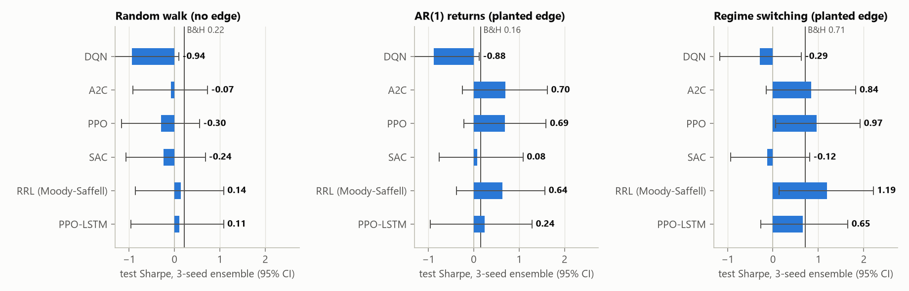

* **Nothing beats noise on the random walk.** Agents land between −0.94 and +0.14, inside the random-strategy
  band of −0.87 to +0.65. This is the environment-level evidence that no future information reaches the
  observation. DQN's −0.94 is costs: it turns the book over 150 times a year.
* **PPO, A2C and RRL find both planted edges**, at the level of the best supervised baseline. RRL needs by far
  the least trading (6-14 turns a year against 30-90): its recurrence on its own last position puts costs inside
  the objective.
* **DQN and SAC fail at γ = 0.95, yet exploit an oracle feature to a Sharpe of 13-14** (Section 7.9). That is a
  signal-to-noise problem, not a bug.

**Discounting in a price-taker setting.** The agent's trade does not move the market, so its action reaches
future rewards only through the position it carries. With γ = 0.95, each bootstrapped target adds about 20 days
of unrelated price noise to an edge of a few hundredths of a percent per day. A sweep (2 seeds, 100k steps) left
PPO indifferent. The bootstrapping agents were erratic, but better than at 0.95 at every lower value tried.
On that synthetic evidence alone, and before any real test window was evaluated, value-based agents use γ = 0.5
for everything that follows; the PPO family keeps 0.95.

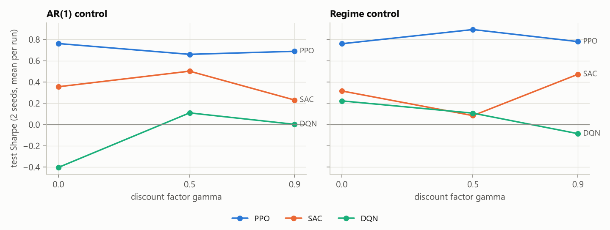

### 7.2 Baselines on SPY

All baselines go through the same environment (next-open fills, every cost). Test blocks 2007-2018 are chained:

| Strategy | Sharpe [95% CI] | CAGR | Max DD | Turnover/yr |
|---|---|---|---|---|
| MA 50/200 trend filter | **0.61** [0.17, 1.14] | 7.9% | −19% | 1.3 |
| Volatility target (15%) | 0.56 [0.05, 1.10] | 7.5% | −33% | 3.0 |
| RSI(2) dip-buying | 0.54 [0.09, 0.99] | 4.0% | −9% | 14 |
| 12-month momentum, long/flat | 0.54 [0.08, 1.06] | 7.4% | −20% | 4.5 |
| Mean-variance (fractional Kelly) | 0.53 [0.04, 1.06] | 6.0% | −17% | 2.0 |
| 5-day mean reversion | 0.48 [0.03, 0.92] | 5.5% | −17% | 62 |
| Logistic regression | 0.45 [−0.01, 0.97] | 6.9% | −32% | 37 |
| **Buy & hold** | **0.41** [−0.05, 0.98] | 7.1% | −55% | 0.5 |
| Gradient boosting / ridge | 0.23 / 0.21 | 3.1% / 3.0% | −28% / −41% | 64 / 72 |
| Random positions (20 seeds) | mean −0.01, 90% band −0.32 to +0.34 | | | |

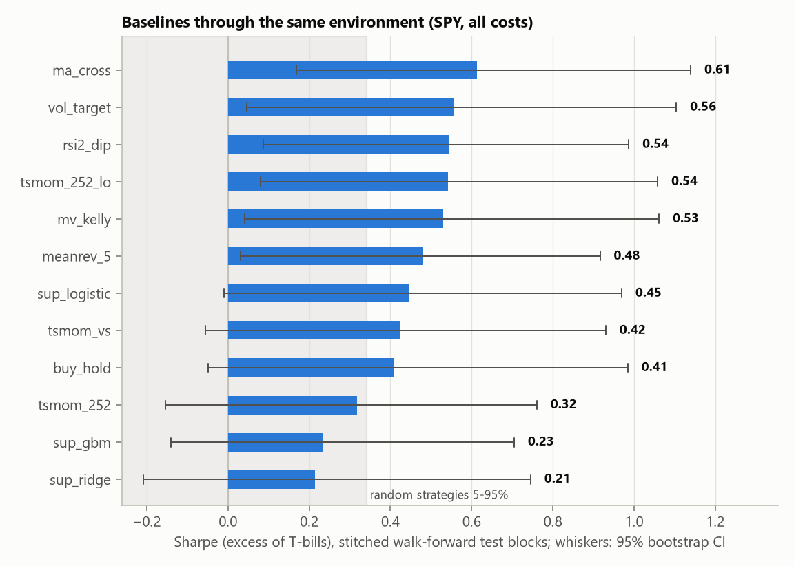

Every interval overlaps buy & hold's. The rules' advantage is risk reduction (drawdowns of 9-33% against 55%), not
extra return. The supervised models trade 37-72 times a year and give much of their forecast skill back in costs.

### 7.3 Nine RL agents on SPY (6 folds × 3 seeds = 162 runs)

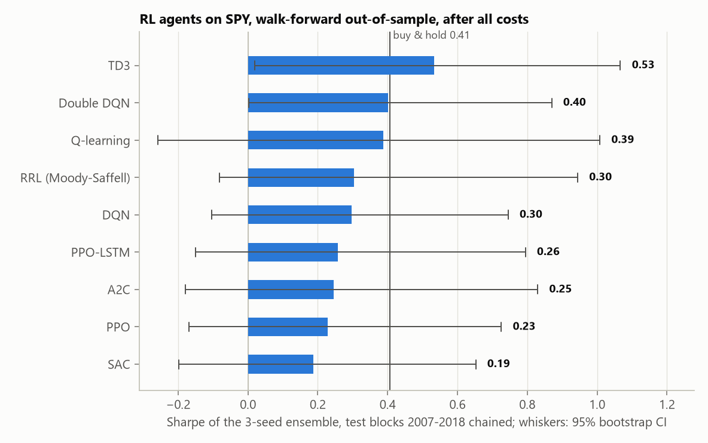

| Agent | Ensemble Sharpe [95% CI] | Seed range | vs buy & hold (p) | CAGR | Max DD | Turnover | Avg gross |
|---|---|---|---|---|---|---|---|
| TD3 | 0.53 [0.02, 1.07] | 0.20-0.37 | +0.13 (0.39) | 5.7% | −26% | 60 | 0.82 |
| Double DQN | 0.40 [0.00, 0.87] | 0.10-0.59 | −0.01 (0.52) | 5.7% | −26% | 141 | 0.81 |
| Q-learning | 0.39 [−0.26, 1.01] | 0.01-0.50 | −0.02 (0.52) | 3.5% | −18% | 42 | 0.30 |
| RRL | 0.30 [−0.08, 0.94] | 0.27-0.35 | −0.10 (0.71) | 3.0% | −22% | 6 | 0.13 |
| DQN | 0.30 [−0.10, 0.75] | 0.07-0.37 | −0.11 (0.64) | 4.2% | −28% | 144 | 0.83 |
| PPO-LSTM | 0.26 [−0.15, 0.79] | 0.14-0.33 | −0.15 (0.81) | 3.0% | −28% | 13 | 0.38 |
| A2C | 0.25 [−0.18, 0.83] | 0.17-0.33 | −0.16 (0.74) | 3.2% | −37% | 40 | 0.46 |
| PPO | 0.23 [−0.17, 0.73] | 0.03-0.31 | −0.18 (0.78) | 2.9% | −33% | 32 | 0.46 |
| SAC | 0.19 [−0.20, 0.65] | 0.01-0.36 | −0.22 (0.78) | 2.4% | −26% | 79 | 0.52 |

* **No agent is distinguishable from buy & hold, and all trail the trend filter and vol targeting.**
* **Seed ensembles beat single seeds.** TD3's three seeds score 0.20-0.37 individually and 0.53 averaged: seeds
  make partly independent mistakes, and averaging their positions removes some of the noise.
* **The block-by-block pattern is a low-beta SPY.** Agents beat buy & hold in 2007-08 (−0.53 for SPY) by holding
  less, and trail it in the 2013-14 rally (SPY 1.78). RRL is the only agent positive in every block. DQN and Double
  DQN flip between long and short about 140 times a year and pay 3% a year for it.

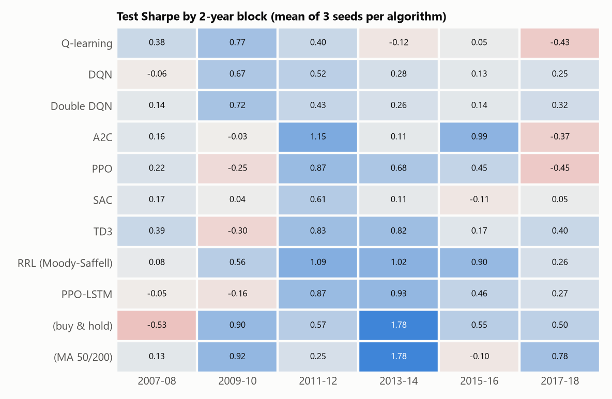

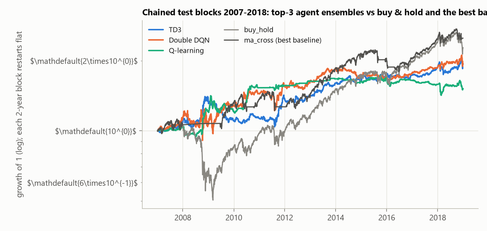

### 7.4 What training selects: validation does not predict test

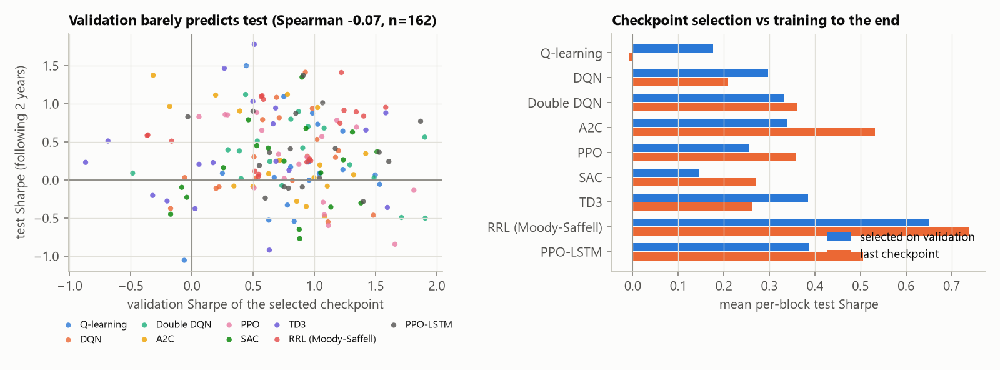

* Across 162 runs, the validation Sharpe of the selected checkpoint has a rank correlation of **−0.08** with the
  following two years' test Sharpe.
* For six of nine algorithms, the **last** checkpoint beat the validation-selected one: A2C 0.53 vs 0.34, PPO 0.36
  vs 0.25, SAC 0.27 vs 0.15, PPO-LSTM 0.51 vs 0.39, RRL 0.74 vs 0.65, Double DQN 0.36 vs 0.33 (mean per-block
  Sharpe).
* A 2-year validation window has a Sharpe standard error of about 0.7. Selecting the best of 20 checkpoints on it
  mostly selects noise. The same holds for hyperparameter search (Section 7.8).

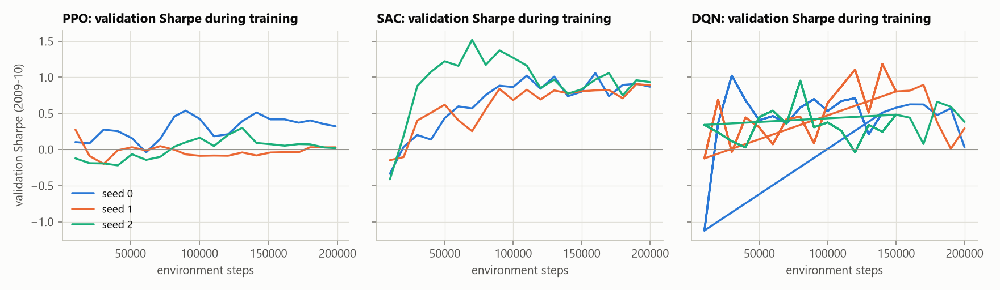

### 7.5 Reward functions (PPO, 6 folds × 2 seeds)

| Reward | Sharpe [95% CI] | CAGR | Max DD | Avg gross |
|---|---|---|---|---|
| log return | 0.61 [0.20, 1.10] | 7.4% | −20% | 0.46 |
| log return + inventory penalty | 0.42 [0.02, 0.91] | 5.4% | −25% | 0.45 |
| excess return | 0.41 [−0.02, 0.89] | 5.5% | −25% | 0.56 |
| differential Sharpe | 0.40 [0.00, 0.86] | 4.7% | −19% | 0.52 |
| volatility-scaled return | 0.39 [−0.04, 0.82] | 4.8% | −25% | 0.52 |
| differential downside deviation | 0.33 [−0.07, 0.89] | 4.3% | −32% | 0.42 |
| absolute P&L | 0.30 [−0.10, 0.83] | 3.8% | −32% | 0.39 |
| log return + drawdown penalty | 0.29 [−0.09, 0.77] | 2.2% | **−11%** | 0.17 |
| mean-variance utility | 0.26 [−0.14, 0.80] | 3.2% | −31% | 0.34 |
| log return + cost penalty | 0.24 [−0.19, 0.73] | 3.3% | −34% | 0.59 |
| log return + turnover penalty | 0.23 [−0.22, 0.75] | 2.9% | −33% | 0.52 |
| own-volatility risk-adjusted | 0.18 [−0.22, 0.63] | 2.2% | −28% | 0.49 |

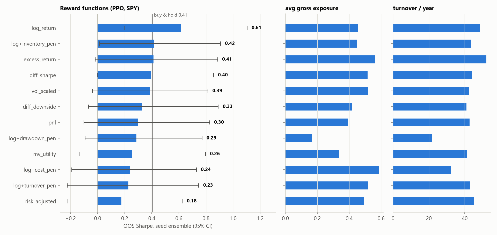

* **No reward beats buy & hold significantly** (the best paired p-value is 0.22).
* **The ranking is not stable.** The log-return configuration that tops this table scores 0.23 in the main
  experiment: identical except for the seeds (3 vs 2) and training length (200k vs 100k steps). Run-to-run
  variance is as large as the differences between rewards.
* **Penalties do what they say.** The drawdown penalty halves the worst drawdown (−11% against −20%) by cutting
  exposure to 17%.

### 7.6 Reward hacking and unstable objectives (PPO, 3 folds incl. 2007-08, 2 seeds)

| Variant | Test Sharpe [95% CI] | Avg gross | Max DD | Training episodes ended early |
|---|---|---|---|---|
| log return (reference) | 0.69 [0.16, 1.45] | 0.54 | −25% | 0% |
| + drawdown penalty λ = 1 / 5 / 20 | 0.35 / 0.59 / 0.62 | 0.17 / 0.10 / 0.06 | −15% / −6% / −5% | 0% |
| + inventory penalty 2 / 5 / 20 bp/day | 0.44 / 0.51 / 0.62 | 0.54 / 0.36 / 0.19 | −32% / −20% / −14% | 0% |
| drawdown-level penalty, no stop | 0.44 | 0.26 | −21% | 0% |
| + 10% drawdown stop with penalty | 0.55 | 0.13 | −9% | 60% |
| + 10% drawdown stop, no penalty | 0.76 | 0.37 | −17% | 60% |
| differential Sharpe, excess returns + variance floor | 0.50 | 0.65 | −28% | 0% |
| differential Sharpe, raw returns, no floor | 0.68 | 0.65 | −18% | 0% |
| 3x leverage, absolute P&L reward | 0.90 | 1.67 | −33% | 0% |
| 3x leverage, log-return reward | 0.48 | 1.49 | **−68%** | 0% |
| own-vol risk-adjusted, with floor / no floor | 0.92 / 0.25 | 0.43 / 0.44 | −16% / −30% | 0% |

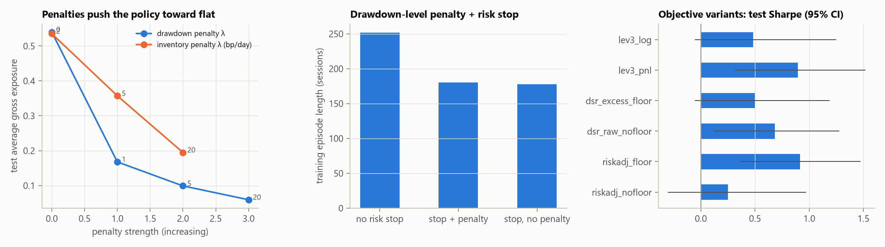

What happened, against what the textbook predicts:

1. **Exposure collapse.** Heavier drawdown or inventory penalties shrink the deterministic policy toward flat
   (gross 0.54 → 0.06). The Sharpe ratio survives, because it is scale-free, while CAGR falls to T-bill levels. A
   Sharpe-only scorecard would not notice that the agent stopped investing. Behaviour metrics (exposure,
   turnover) belong next to performance metrics.
2. **A free risk stop invites risk.** With a drawdown-level penalty, terminating the episode stops the stream of
   penalties. With no terminal penalty, 60% of training episodes end at the stop. The agent runs more exposure
   than the penalised variant: 0.61 against 0.46 in training, 0.37 against 0.13 in test. That is the
   early-termination incentive in a mild form; the textbook version is an agent that deliberately blows up.
3. **The zero-variance exploit exists but was not found.** The differential Sharpe on raw returns without a
   variance floor rewards an all-cash policy (constant T-bill return, variance → 0) with 3.65 per year. That is
   more than the 2.25 PPO actually earned with this reward. On excess returns with a floor, cash earns exactly 0.
   PPO's Gaussian exploration never reached the knife-edge of exactly zero position. The defence is to define the
   objective correctly, not to rely on the optimiser missing the exploit.
4. **Leverage.** Both risk-neutral (P&L) and growth-optimal (log) rewards lever up to about 2x. The log-return
   agent suffered the deeper test drawdown (−68% against −33%), the opposite of the theory. With 3 folds × 2
   seeds the difference is noise, which is itself the lesson.
5. **Unstable objectives.** Dividing by the agent's own volatility estimate without a floor (0.25) against with
   one (0.92). The same "with floor" configuration scores 0.18 in the 6-fold reward study. A 3-fold result can be
   off by more than 0.7 Sharpe.

### 7.7 State representation (PPO, 6 folds × 2 seeds)

| Feature set | Sharpe [95% CI] | Turnover | Avg gross |
|---|---|---|---|
| all 36 features | 0.44 [0.03, 0.93] | 68 | 0.51 |
| 5 returns only | 0.41 [−0.06, 0.92] | 28 | 0.39 |
| returns + volatility + technical | 0.38 | 42 | 0.34 |
| compact (default, 14) | 0.37 | 46 | 0.48 |
| compact, 5-day window | 0.35 | 35 | 0.26 |
| returns + volatility + order flow | 0.33 | 43 | 0.31 |
| returns + volatility + volume | 0.32 | 48 | 0.39 |
| compact **without its own position** | 0.29 | 45 | 0.35 |
| returns + volatility + regime | 0.29 | 41 | 0.36 |
| returns + volatility | 0.27 [−0.19, 0.82] | 58 | 0.41 |

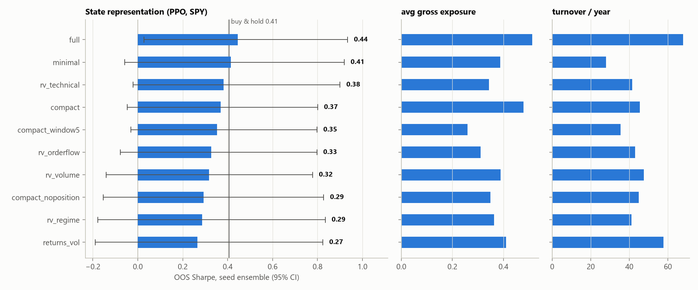

No feature group makes a detectable difference; every interval overlaps. Five raw returns do as well as 36
engineered features. Hiding the agent's own position, which in theory makes trading costs unobservable, changes
neither performance nor turnover by a detectable amount. With daily data the signal is small enough that the
choice of state is second-order to the variance of training itself.

### 7.8 Training methodology: randomised environments, pooling, hyperparameter search

| Training variant (PPO, 6 folds × 2 seeds, 150k steps) | Sharpe [95% CI] | Turnover |
|---|---|---|
| block-bootstrapped SPY histories (8 paths from the training window) | 0.54 [0.08, 1.02] | 47 |
| base (SPY from 1994) | 0.49 [0.10, 0.97] | 40 |
| 19-instrument pool + cost randomisation | 0.45 [0.07, 0.92] | 30 |
| SPY from 2001 (like-for-like control for the pool) | 0.41 [−0.04, 0.96] | 46 |
| 19-instrument pool (SPY + 8 ETFs + 10 stocks) | 0.36 [−0.06, 0.90] | 38 |
| cost randomisation (0.5x-3x, slippage 0-3 bp) | 0.30 [−0.12, 0.80] | 34 |
| observation noise (σ = 0.1) | 0.18 [−0.21, 0.69] | 37 |

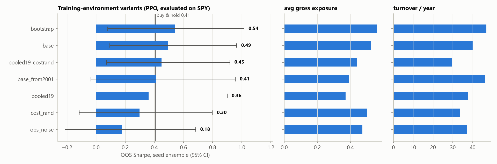

No variant beats the base setup. Pooling across 19 instruments does not beat its like-for-like control
(0.36-0.45 against 0.41); cost randomisation lowers turnover but not risk-adjusted return.

**Hyperparameter search.** 24 TPE trials tuned 12 PPO hyperparameters, including reward, features, episode length
and a no-trade band, on the mean validation Sharpe of folds 1-3 (validation 2005-2010). The best trial scored
1.16 on validation. Tuning on fold *k*'s validation window contaminates earlier folds' test windows, so the tuned
configuration is judged only on folds 4-6 (test 2013-2018) and the holdout.

| PPO on folds 4-6 (test 2013-2018), 3 seeds | Validation Sharpe | Test Sharpe [95% CI] | Turnover | Avg gross |
|---|---|---|---|---|
| default | (not tuned) | 0.34 [−0.26, 0.91] | 40 | 0.42 |
| tuned (best of 24 trials) | 1.16 on folds 1-3 | **−0.09** [−0.79, 0.59] | 2.3 | **0.03** |

The search found a policy that is almost always flat: a 20% no-trade band combined with a volatility-scaled
reward. Writing this report exposed why. A completely flat policy's "Sharpe ratio" was the ratio of two rounding
errors (Section 9), and several flat checkpoints scored around 1.2 on validation by accident. **The original
search therefore rewarded doing nothing.** After the metric was fixed, the full search was repeated as
`hpo_ppo_spy_v2`:

| Search (24 TPE trials each) | Best validation Sharpe, folds 1-3 | Winning configuration | Folds 4-6 test: tuned vs default |
|---|---|---|---|
| original (flawed metric) | 1.16 | volatility-scaled reward, 20% no-trade band, all 36 features, 63-day episodes | −0.09 vs 0.34 |
| repeated after the fix | 1.04 | differential-Sharpe reward, 10% no-trade band, returns + volatility features, 252-day episodes, learning rate 6e-5 | **0.24 vs 0.27** |

With the metric fixed, the search picks an active, sensible-looking policy (35% average exposure, 42 turns a
year). No flat checkpoint was selected anywhere in it. The policy still does not beat the untuned default on the
clean folds, and both sit far below buy & hold's 0.88 over 2013-2018. The tuned policy scores 1.12 on its own
validation windows against 0.23 on test. The untuned default scored 0.34 in one evaluation and 0.27 in the other,
which differ only in their seeds. **Tuning on validation Sharpe bought nothing that survives out of sample.**

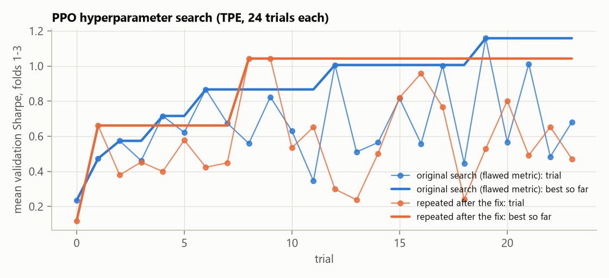

### 7.9 Execution assumptions and leakage

**Fill assumptions.** Baselines (re-run under each assumption):

| Strategy (turnover/yr) | next open (default) | next close | same close | zero costs | 4x costs |
|---|---|---|---|---|---|
| 5-day mean reversion (62) | 0.47 | 0.27 | 0.47 | 0.60 | 0.15 |
| ridge regression (72) | 0.21 | 0.38 | 0.29 | 0.36 | −0.02 |
| logistic regression (37) | 0.44 | 0.50 | 0.52 | 0.49 | 0.39 |
| RSI(2) dip (14) | 0.54 | 0.48 | 0.53 | 0.59 | 0.41 |
| MA 50/200 (1.3) | 0.61 | 0.60 | 0.63 | 0.61 | 0.61 |

PPO trained and tested under each fill: next open 0.34, next close 0.29, same close 0.42. In SPY the same-close
shortcut is worth only about +0.1 Sharpe, because spreads are tiny. Costs matter more, but only for strategies
that trade weekly or faster.

**Planted look-ahead.** One extra feature each, PPO; mean test Sharpe of the runs (random walk: 1 fold × 2
seeds; SPY: 3 folds × 2 seeds):

| Leak | Random walk | SPY (3 folds) |
|---|---|---|
| none | −0.27 | 0.67 |
| centred 21-day moving average (10 future days in the window) | **6.93** | **5.21** |
| HMM *smoothed* (forward-backward) regime probability | 0.38 | 0.91 |
| price z-scored with full-sample mean/std | −0.16 | 0.62 |
| next session's return (oracle) | 14.17 | 11.01 |

* Given the oracle, every algorithm reaches 12-14 on the random walk: DQN 13.4, Double DQN 13.2, Q-learning 12.3,
  SAC 14.1, TD3 13.6, A2C 14.1, PPO 14.2, PPO-LSTM 14.1, RRL 14.2. Each implementation can learn; none is broken.
* **A single subtly leaky feature turns a random walk into a Sharpe of 7.** Validation is fooled just as much
  (7.2), so the only defences are the causality test (which flags all four leaks) and negative controls. Anything
  above about 2 on daily data should be treated as a bug until proven otherwise.
* Smoothed regime probabilities leak modestly (+0.24 on SPY, +0.65 on the random walk, both within noise), which
  is how this mistake survives in published work.

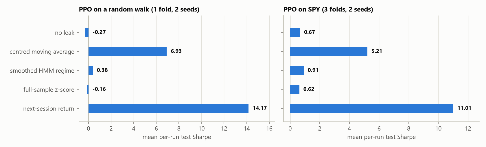

### 7.10 Multiple instruments

| Universe (test window) | RL agents (seed ensembles) | Best baselines |
|---|---|---|
| 9 ETFs, portfolio (2011-18) | PPO-LSTM 0.52, A2C 0.41, TD3 0.33, PPO 0.11, RRL −0.01, SAC −0.06 | min variance 1.09, 60/40 1.00, risk parity 0.93, equal weight 0.66 |
| ES, NQ, YM, ZN, portfolio (2011-18) | A2C 0.59, PPO 0.49, SAC 0.37, RRL −0.01 | min variance 1.18, inverse vol 1.09, equal weight 0.93 |
| 10 end-2000 large caps, pooled (2007-18) | RRL 0.04, PPO 0.01, DQN −0.34 | mean-variance 0.45, MA 50/200 0.43, buy & hold 0.25 |

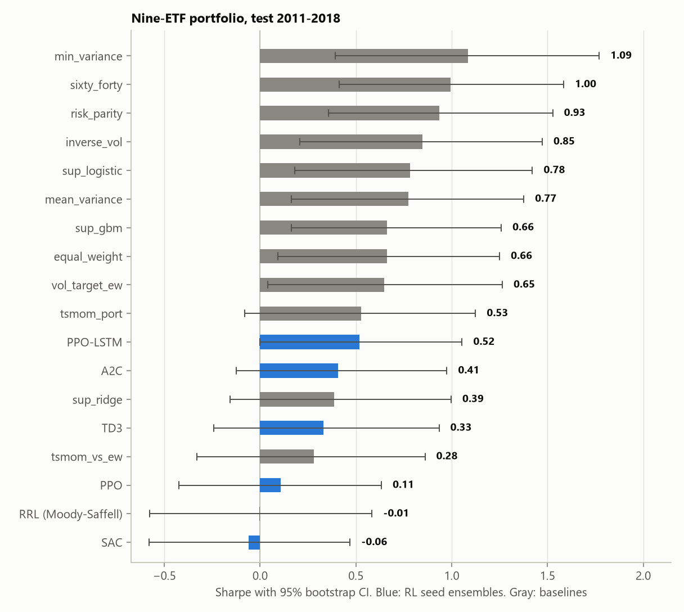

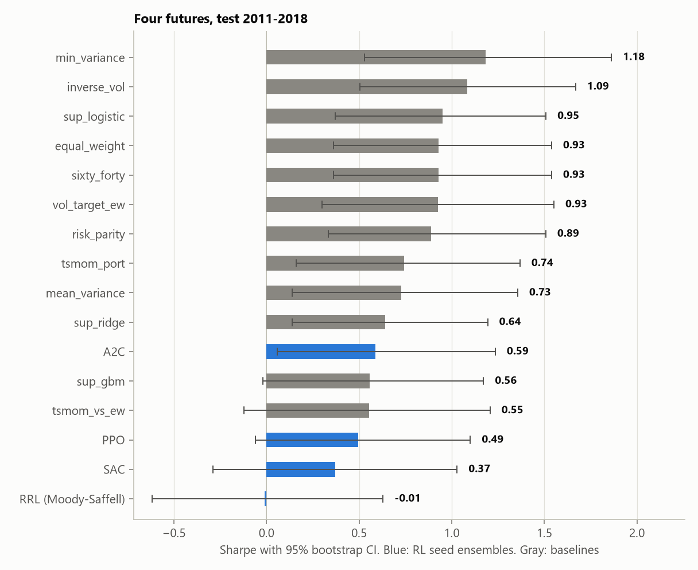

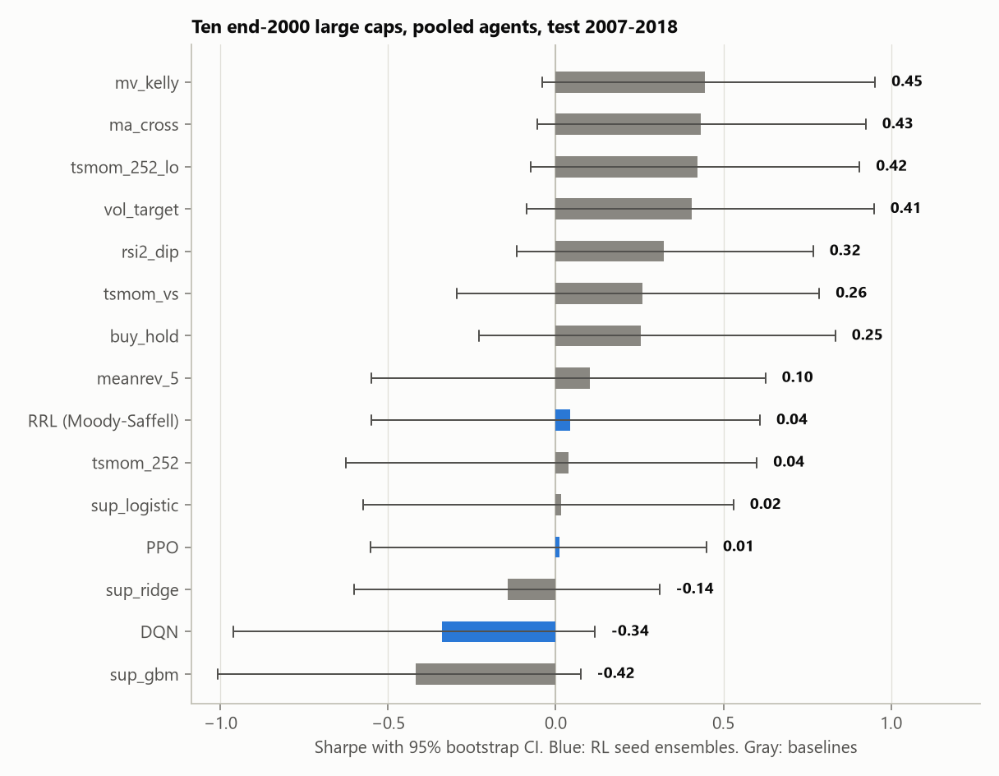

* **Allocation rules win.** The multi-asset baselines' edge is diversification and risk balancing at a turnover of
  about one per year. The agents trade the 9-ETF book 120-180 times a year and do not learn to diversify within
  200k steps.
* **Single stocks are harder still.** The pooled single-stock agents hold too little in a period when the ten
  names returned almost nothing (buy & hold 0.25, −71% drawdown).

### 7.11 Costs and capacity

Re-scoring each SPY checkpoint under different costs and capital (mean per-block Sharpe):

| | 0x costs | 1x | 4x | $10M | $100M | $1B | $10B |
|---|---|---|---|---|---|---|---|
| DQN / Double DQN (~140 turns/yr) | 0.52 / 0.54 | 0.30 / 0.33 | −0.27 / −0.25 | 0.20 / 0.24 | −0.04 / −0.03 | −0.70 / −0.71 | −0.41 / −0.43 |
| SAC (~80) | 0.29 | 0.15 | −0.27 | 0.11 | −0.02 | −0.40 | −0.56 |
| TD3 (~60) | 0.47 | 0.38 | 0.12 | 0.36 | 0.27 | 0.00 | 0.07 |
| PPO (~32) | 0.33 | 0.25 | 0.02 | 0.24 | 0.19 | 0.05 | −0.31 |
| PPO-LSTM (~13) | 0.42 | 0.39 | 0.28 | 0.38 | 0.37 | 0.33 | 0.23 |
| RRL (~6) | 0.68 | 0.65 | 0.55 | 0.65 | 0.64 | 0.61 | 0.53 |
| MA 50/200 | 0.63 | 0.63 | 0.62 | 0.63 | 0.62 | 0.62 | 0.60 |
| buy & hold | 0.63 | 0.63 | 0.63 | 0.63 | 0.63 | 0.63 | 0.63 |

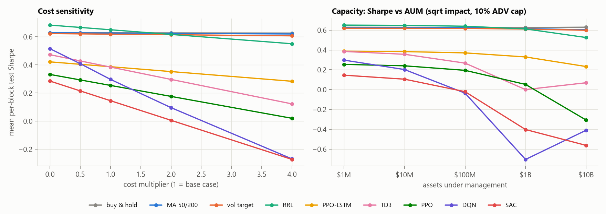

* **Capacity follows turnover.** The high-turnover agents lose half their Sharpe between $10M and $100M, in the
  most liquid ETF in the world: 140 turns a year means trading over half the book every day. RRL and the
  low-turnover baselines keep their Sharpe to $10B.
* **Caveat.** These capacity figures are optimistic. Opening-auction fills up to 10% of ADV with only
  square-root impact understate the true cost of size.

### 7.12 Significance after search

* **Trials.** 72 strategies were evaluated on the SPY development test windows: baselines and every RL
  configuration and variant. Infeasible variants (same-close fills, leaky features) are excluded.
* **Best Sharpe.** PPO with the log-return reward, 0.61. Its deflated probability of a true Sharpe above zero is
  0.88. But buy & hold itself scores 0.67 on that test, so "Sharpe > 0" is the wrong question for strategies that
  are long US equities in 2007-2018.
* **Against buy & hold.** Every strategy's active return (minus buy & hold) has a **non-positive** information
  ratio. The best is −0.03 (MA 50/200), with a deflated probability of skill of 0.17. Over 2007-2018, no strategy
  in this lab, rule or RL, earned more than holding SPY. The higher Sharpe ratios came from holding less risk.

### 7.13 Final holdout: 2019-01 to 2026-11 (evaluated once)

Trained 1994-2016, validated 2017-18, tested 2019-01-02 to 2026-11-11. The test covers the 2020 crash, the 2022
bear market and the 2023-26 rally. All nine default agents and the tuned PPO were frozen beforehand, and each was
run once with three seeds; the baseline suite was run once on the same window.

| Strategy | Sharpe [95% CI] | CAGR | Max DD | Turnover/yr |
|---|---|---|---|---|
| logistic regression (baseline) | 0.91 [0.30, 1.65] | 19.2% | −34% | 35 |
| volatility target (baseline) | 0.83 [0.22, 1.50] | 14.0% | −19% | 2.6 |
| **buy & hold** | **0.77** [0.18, 1.48] | 17.0% | −34% | 0.1 |
| mean-variance / Kelly (baseline) | 0.71 [0.06, 1.40] | 11.6% | −17% | 1.3 |
| PPO-LSTM | 0.67 [0.06, 1.42] | 13.7% | −33% | 12 |
| A2C | 0.63 [0.07, 1.41] | 12.8% | −31% | 50 |
| 12-month momentum, long/flat (baseline) | 0.63 | 11.7% | −28% | 2.7 |
| PPO | 0.61 [0.06, 1.30] | 6.9% | −12% | 29 |
| SAC | 0.59 [0.06, 1.23] | 8.1% | −15% | 75 |
| RRL | 0.55 [0.08, 1.24] | 6.0% | −11% | 5 |
| MA 50/200 (baseline) | 0.53 [−0.06, 1.32] | 10.5% | −34% | 0.9 |
| TD3 | 0.43 [0.00, 0.96] | 8.2% | −23% | 89 |
| PPO, tuned (by the original, flawed search) | 0.40 [0.02, 0.99] | 3.6% | −3% | 5 |
| Double DQN | 0.31 [−0.26, 0.87] | 6.1% | −18% | 112 |
| DQN | 0.09 [−0.44, 0.61] | 3.1% | −19% | 131 |
| Q-learning | −0.52 [−1.17, 0.16] | −1.2% | −24% | 52 |
| random positions (20 seeds) | mean −0.07, 90% band −0.44 to +0.48 | | | |

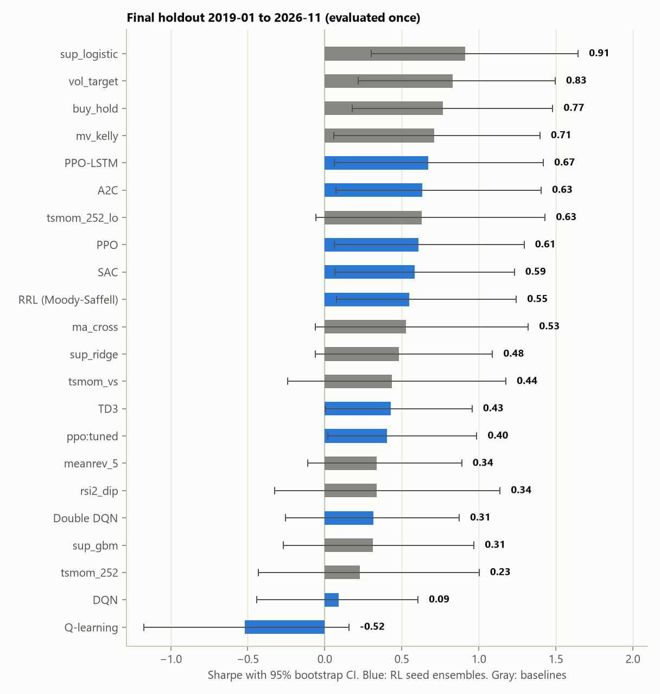

* **Every RL configuration trails buy & hold** (paired p ≥ 0.69). The two baselines above it, logistic regression
  and volatility targeting, have intervals that overlap it widely. Logistic regression was mediocre in
  development (0.44), so its first place here is no more trustworthy than TD3's in development.
* **Rankings do not persist.** Across the nine algorithms, development and holdout Sharpe have a rank
  correlation of −0.63. The value-based agents that led in development (TD3, Double DQN, Q-learning) are at the
  bottom, and the on-policy agents (PPO-LSTM, A2C, PPO) at the top. With 2-3 seeds and two regimes, that is what
  noise around a common, near-zero edge looks like.
* **Behaviour carried over even when performance did not.** The low-turnover agents (RRL, PPO) again ran small
  books with shallow drawdowns (−11% and −12% against −34% for SPY), and the high-turnover value-based agents
  again paid for their trading.
* **Validation was again uninformative.** Q-learning had the second-best 2017-18 validation Sharpe (0.82) and
  the worst holdout result.
* **Caveat on the tuned PPO.** Its configuration came from the original search, whose objective was corrupted
  by flat-book noise (Section 9). Two of its three seeds held no position at all on the holdout, so its
  ensemble is one active seed diluted to a third. The corrected search (Section 7.8) was evaluated only on
  development folds 4-6, because the holdout had already been used once.

## 8. Discussion: what an RL researcher and a trader should take from this

1. **Daily-bar RL on liquid index products learns a noisy low-beta version of buy & hold.** The agents' alpha is
   exposure timing at a horizon where the signal-to-noise ratio is tiny. Any value they add comes from cutting
   risk in crashes, which a 200-day moving average does for free and more reliably.
2. **The variance of the training process is the dominant fact.** Seeds, training length, checkpoint choice and
   tuning each move results by as much as the comparisons being made. Single-seed RL backtests in papers are
   uninformative; ensembles of seeds are both more honest and better.
3. **Validation windows are too short to select on.** At about 0.7 standard error per 2-year window, early
   stopping and HPO mostly fit noise. Rank correlation between selected validation and test Sharpe: −0.08.
4. **Turnover is the hidden variable.** It decides cost drag, capacity and sensitivity to fill assumptions.
   Agents with explicit cost awareness (RRL's recurrence on its own position) trade an order of magnitude less and
   hold up best. Discrete long/short action spaces (DQN) are the worst offenders.
5. **Leakage beats every algorithm.** One feature with a centred window turns a random walk into a Sharpe of 7.
   The causality test and negative controls are not optional infrastructure.
6. **Reward design matters less than it seems in performance, and more than it seems in behaviour.** Rewards move
   exposure and drawdown far more reliably than Sharpe. Report behaviour metrics alongside performance, or an
   agent that has quietly stopped investing will look fine.

Where RL could earn its keep, beyond this lab's daily-bar scope: problems where the action changes the state.
Examples are execution (market impact, inventory, queue position), market making, and hedging with frictions.
That is where dynamic programming matters, and a price-taking daily allocator gives up most of RL's advantage.

## 9. Audit, fixes and limitations

**Independent audit.** A separate agent, without access to this analysis, reviewed the code for look-ahead and
unrealistic assumptions.

What it confirmed as correct:
* Timing, sampler bounds and fold edges.
* HMM and scaler fitting.
* Supervised labels, RRL alignment, checkpoint selection and the HPO protocol.
* Roll back-adjustment invariance and the metrics formulas.

What it found, all now fixed:

1. **ZN roll jumps:** about −60 bp per switch (Section 2).
2. **Split-inconsistent dollar volume:** distorted impact costs and two volume features for stocks with splits.
3. **Hindsight in the end-2000 stock universe** before 2001.
4. **Short financing too cheap:** full T-bill rebate, no 2008 short-sale ban.
5. **Evaluation records truncated at risk stops.**
6. **A mis-specified deflated Sharpe:** a different statistic selected than tested, and too few trials counted.
7. **Mixed code versions and silent incomplete runs.** Every run now records an environment version and code
   fingerprint. A cached run is reused only if its spec matches exactly, and incomplete fold sets are refused.
8. **Calendar rebalancers idled a month per test block.**
9. **An advisory-only holdout guard.** Every load of holdout data is now logged.

Runs finished before the fixes were re-scored from their saved checkpoints. Only 8 of 548 moved by more than
0.05 Sharpe, mostly the risk-stop variants of item 5.

**Found while writing this report: flat books had float-noise Sharpe ratios.**
* **The bug.** A policy that never trades earns exactly the T-bill rate, so its excess return is zero up to
  rounding (about 1e-17). Its "Sharpe ratio" was the ratio of two rounding errors and could be anything: two flat
  seeds scored 1.19 on one validation fold.
* **Where that number fed in.** Checkpoint selection, and the hyperparameter search's objective.
* **The fix.** A daily excess-return volatility below 1e-9 now counts as a flat book with Sharpe 0, covered by a
  regression test.
* **The scan** (`scripts/scan_flat.py`). One of the 162 main runs had picked a flat checkpoint; it was re-run.
  So had 4 of the 72 search runs: the search was repeated (Section 7.8). Seed ensembles were never affected,
  because a flat seed simply contributes zero returns.

**Disclosed deviations.**
* A 20k-step plumbing smoke test printed fold-1 (2007-08) test Sharpe ratios once, before the experiments. No
  setting was chosen from them; smoke tests now run on synthetic data.
* Value-based agents' discount factor was set from the synthetic controls, which were run at the 0.95 default.
* The DQN/SAC oracle check ran for 200k steps at γ = 0.95, before the default changed.

**Limitations.**
* **Data.** Daily bars from a free source, with no intraday, order-book or true order-flow data. Yahoo's
  continuous futures need repair. The ETF and futures universes are instruments that exist today.
* **Costs.** Cost parameters are generic, not broker quotes, and are modern-looking for 2007-2010 opening
  auctions. The 2x and 4x sensitivity shows which conclusions depend on them.
* **Statistical power.** 2-3 seeds per configuration and 12 years of test data. Differences below about 0.3
  Sharpe cannot be resolved, which is a result in itself.
* **Training budget.** 100-200k steps per run. Larger networks and longer training would more likely deepen
  overfitting than find an edge, given the validation-test evidence, but this was not tested.

## 10. Reproduction

```bash
.venv/Scripts/python scripts/download_data.py
.venv/Scripts/python -m pytest tests -q
.venv/Scripts/python scripts/run_baselines.py --universe spy etf9 fut4 eq10_2000 syn:gbm syn:ar1 syn:regime
.venv/Scripts/python scripts/run_experiments.py controls gamma main rewards hacking leakage features execution randomized portfolio futures equities
.venv/Scripts/python scripts/run_hpo.py search
.venv/Scripts/python scripts/run_hpo.py evaluate
.venv/Scripts/python scripts/run_robustness.py main_spy
.venv/Scripts/python scripts/run_holdout.py rl
.venv/Scripts/python scripts/run_holdout.py baselines
.venv/Scripts/python scripts/build_report.py
```

Every run directory records its full spec, derived seed, environment version, code fingerprint and package
versions. Each figure above is regenerated from `runs/` by `scripts/build_report.py`, and the training dashboard
(`rlt/dashboard/server.py`, port 8795) shows the same runs live.
